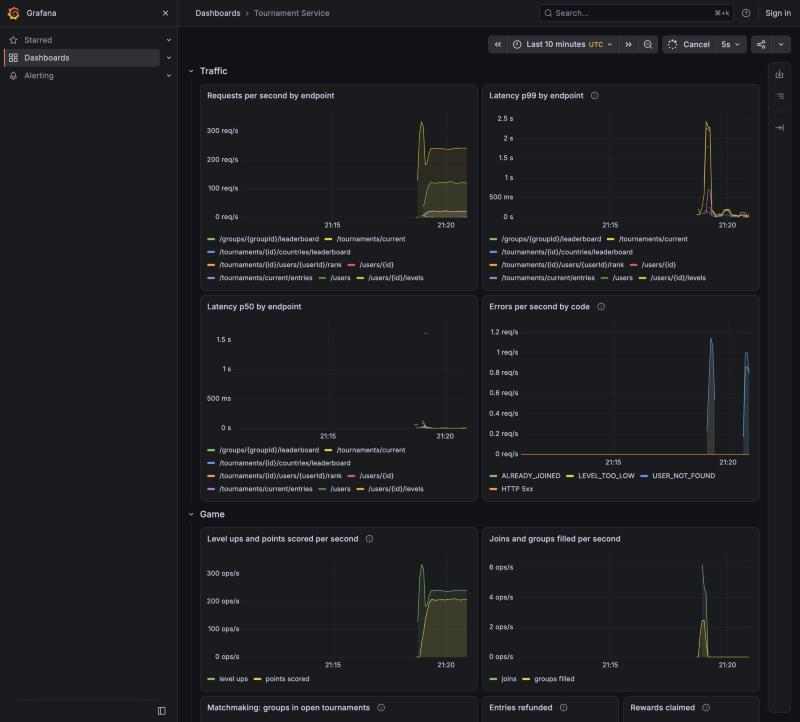

# Tournament and Leaderboard Service

A Spring Boot backend for a match-3 game. Players pass levels to earn coins, join a daily
tournament in groups of five with one player per country, and compete on live group and country
leaderboards kept in Redis, with Postgres as the source of truth.

- When 200 players join at once, each is charged exactly once and no group gets two players from
  the same country.
- When one player sends 10 reward claims at once, the reward is paid once.
- After each load test, every group board and the country board in Redis matched Postgres exactly.
- Under 400 requests/s on a laptop, level ups took 1.5 ms at p50 and 8.0 ms at p99.
- 81 tests run in CI against real Postgres, Redis in cluster mode and Elasticsearch.

Java 21 · Spring Boot 3.5 · Spring Data JPA · PostgreSQL 16 · Redis 7 · Elasticsearch 8 · Flyway ·
Docker Compose · JUnit 5 + Testcontainers · k6 · Actuator, Prometheus and Grafana

## Run it

```bash
docker compose up --build
```

Once the app logs `Started TournamentApplication`, try it from a second terminal over plain HTTP
on this machine (needs `jq`). Sign up returns a token; every other request sends it.

```bash
API=http://localhost:8080
ME=$(curl -s $API/users -H 'Content-Type: application/json' -d '{"username":"alice"}')
ID=$(echo "$ME" | jq -r .id)
AUTH="Authorization: Bearer $(echo "$ME" | jq -r .token)"
# Joining needs level 20; every level up also pays 25 coins.
for i in $(seq 19); do curl -s -o /dev/null -XPOST $API/users/$ID/levels -H "$AUTH"; done
curl -s -XPOST $API/tournaments/current/entries -H "$AUTH" -H 'Content-Type: application/json' \
  -d "{\"userId\":$ID}"
```

The join returns your group, `WAITING` until one player from each of the five countries is in it,
then `ACTIVE`; from then on every level up scores a point on the group and country leaderboards.
The tournament runs from 00:00 to 20:00 UTC. To try it after 20:00 UTC, stretch the window:
`TOURNAMENT_CLOSES_AT=24h docker compose up --build`.

### HTTPS and local development

Secrets come from a git-ignored `.env` file; [.env.example](.env.example) lists them with
local-only defaults. Set real values anywhere other than a laptop, above all `AUTH_TOKEN_SECRET`.

The network reaches the API only over HTTPS, through Caddy on port 8443; bearer tokens never cross
the network in clear. Caddy ends TLS and forwards to the app inside the Docker network, as a load
balancer would. Everything else is bound to `127.0.0.1`, because in Compose Postgres uses
development credentials, Redis has no password, and Grafana allows anonymous viewing. In a real
deployment, don't publish those ports at all.

| Port | What | Reachable from |
|---|---|---|
| 8443 | The API over HTTPS (Caddy); every call but sign up needs a token | the network |
| 8080 | The API over plain HTTP, for local tools (k6, curl) | this machine only |
| 8081 | Actuator: health, metrics, Prometheus | this machine only |
| 3000 / 9090 | Grafana dashboard (home page; `admin`/`admin` edits) / Prometheus | this machine only |
| 9200 | Elasticsearch, HTTPS with a password | this machine only |
| 5433 / 6379 | Postgres (5433 so it doesn't clash with a local one) / Redis | this machine only |

Caddy signs its certificates with its own local CA. Take its root once, then call the API the
way clients do, over HTTPS:

```bash
mkdir -p certs && docker compose cp caddy:/data/caddy/pki/authorities/local/root.crt certs/caddy-root.crt
API=https://localhost:8443
ME=$(curl -s --cacert certs/caddy-root.crt $API/users -H 'Content-Type: application/json' \
  -d '{"username":"bob"}')
curl -s --cacert certs/caddy-root.crt $API/users/$(echo "$ME" | jq -r .id) \
  -H "Authorization: Bearer $(echo "$ME" | jq -r .token)"
```

The calls in the tour above work the same way with `--cacert certs/caddy-root.crt`. To reach it
from other machines, give it a name they resolve and list it:
`PUBLIC_HOSTS="localhost, tournament.example"`. Clients connecting by bare IP send no server name,
so TLS needs a hostname. For a real domain, remove `local_certs` from the
[Caddyfile](monitoring/caddy/Caddyfile) and Caddy fetches a public certificate.

From an IDE (JDK 21), start the backing services, take Elasticsearch's CA certificate out of
its volume, and point the app at them:

```bash
docker compose up -d postgres redis es-setup elasticsearch
mkdir -p certs && docker compose cp elasticsearch:/usr/share/elasticsearch/config/certs/ca/ca.crt certs/ca.crt
ELASTICSEARCH_URIS=https://localhost:9200 SPRING_ELASTICSEARCH_USERNAME=tournament_app \
  SPRING_ELASTICSEARCH_PASSWORD=app-local-only SPRING_ELASTICSEARCH_RESTCLIENT_SSL_BUNDLE=elasticsearch \
  SPRING_SSL_BUNDLE_PEM_ELASTICSEARCH_TRUSTSTORE_CERTIFICATE=file:certs/ca.crt ./mvnw spring-boot:run
```

## API

`User` is `{id, username, country, level, coins}`. Errors are `{code, message}`. Every request
except sign up needs `Authorization: Bearer <token>`. **Self** means the token must be for that
very player; **player** means any valid token.

| Method | Path | Body | Who | Returns |
|---|---|---|---|---|
| POST | `/users` | `{username}` | anyone | `User` + `token`, `tokenExpiresAt` (201) |
| GET | `/users/{id}` | | self | `User` |
| POST | `/users/{id}/levels` | | self | `User` after +1 level, +25 coins |
| POST | `/tournaments/current/entries` | `{userId}` | self | `{groupId, status, leaderboard}` (201) |
| POST | `/users/{id}/rewards/claim` | | self | `User` with the reward added |
| GET | `/groups/{groupId}/leaderboard` | | player | `[{userId, username, country, score}]` |
| GET | `/tournaments/{id}/users/{userId}/rank` | | player | `{rank}` inside the user's group |
| GET | `/tournaments/{id}/countries/leaderboard` | | player | `[{country, score}]` |
| GET | `/tournaments/current` | | player | `{id, startsAt, endsAt, status, open}`; creates today's row if needed |
| GET | `/users/search?q=ahm&country=TR&limit=20` | | player | `[User]`, best match first |

| Code | HTTP | When |
|---|---|---|
| `USER_NOT_FOUND` | 404 | Unknown user id |
| `TOURNAMENT_CLOSED` | 409 | Joining outside the window |
| `LEVEL_TOO_LOW` | 409 | Level below 20 |
| `NOT_ENOUGH_COINS` | 409 | Fewer than 1,000 coins |
| `UNCLAIMED_REWARD` | 409 | A reward from an earlier tournament is still unclaimed |
| `ALREADY_JOINED` | 409 | Already in today's tournament |
| `NO_REWARD` | 404 | Nothing to claim |
| `USERNAME_TAKEN` | 409 | Username exists |
| `UNAUTHORIZED` | 401 | Missing, invalid or expired token |
| `FORBIDDEN` | 403 | Acting as another player (whether or not that id exists) |
| `GROUP_NOT_FOUND`, `TOURNAMENT_NOT_FOUND`, `NOT_IN_TOURNAMENT` | 404 | Unknown ids on leaderboard reads |
| `VALIDATION_ERROR` | 400 | Bad body, path or query |
| `SEARCH_UNAVAILABLE` | 503 | Elasticsearch can't be reached; everything else still works |

Metrics are at `GET /actuator/prometheus` on the management port (8081); see
[Monitoring](#monitoring).

## Game rules

All in [application.yml](src/main/resources/application.yml) under `game.*`; no code changes needed.

| Rule | Property | Default |
|---|---|---|
| Starting balance | `starting-coins` | 5,000 coins, level 1 |
| Countries (= group size) | `countries` | TR, US, GB, DE, FR |
| Per level | `coins-per-level` | +25 coins |
| Window | `tournament.opens-at` / `closes-at` | 0h to 20h after 00:00 UTC |
| Entry | `tournament.min-level` / `entry-fee` | level 20, 1,000 coins |
| Rewards by rank | `tournament.rewards` | 10,000, 5,000 |
| Redis key lifetime | `leaderboard.ttl-after-end` | 2 days after the tournament ends |
| Country board slices | `leaderboard.country-shards` | 8 |
| Country board reuse | `leaderboard.country-board-cache` | 1 second |
| Redis repair | `leaderboard.retry-every` / `reapply-every` | 5 seconds / 5 minutes |
| Settlement catch-up | `tournament.reconcile-every` | every minute |
| Player tokens | `auth.token-ttl` (key: `AUTH_TOKEN_SECRET`) | 30 days |
| Search index check | `search.reconcile-every` | every 10 minutes |

## How the hard parts work

Where this differs from the design doc and why, and the correctness review: [docs/DESIGN.md](docs/DESIGN.md).

**Authentication** ([SecurityConfig](src/main/java/io/github/ahmetcopur/tournament/security/SecurityConfig.java)).
Sign up returns a signed token (HS256, 30 days) whose subject is the user id. Spring Security's
OAuth2 resource server checks signature, issuer and expiry on every request, statelessly. Player
actions then check that the token's subject is the player in the path or body; another player's
id gets 403 whether or not it exists, so ids can't be probed. Operational endpoints are served only
on the management port, and refused on the public port even with a valid token. Moving to a real
identity provider replaces one `JwtDecoder` bean.

**Joining** ([JoinService](src/main/java/io/github/ahmetcopur/tournament/tournament/JoinService.java)).
One Postgres transaction: share-lock the open tournament row, lock the player's row, run the entry
checks, charge the fee with one conditional `UPDATE`, then find a group with
`FOR UPDATE SKIP LOCKED`. Two same-country joins at the same moment skip each other's locked
group rather than queue on it. A failure anywhere rolls the fee back too. The two `UNIQUE`
constraints on `group_members` stay as the safety net.

**Coins.** No read-modify-write. The fee, level ups, refunds and claims are each one `UPDATE`
whose `WHERE` carries the rule. A claim is a single statement: a CTE marks the reward claimed and
the outer `UPDATE` adds the coins, so of two racing claims only one finds a row.

**Level ups during a tournament.** One transaction adds level and coins, then +1 score if the
player's group is `ACTIVE`, the group row share-locked. Redis is updated in an
`@TransactionalEventListener(AFTER_COMMIT)`, so a rolled-back level up never shows on a board.

**The 20:00 cutoff.** A request counts only if it is *processed* before 20:00, meaning it holds
**all** its locks before then, not merely arrived before then. Scoring reads the clock after it holds
both the player's row and the group's row. The time it reads is both the cutoff check and the
tie-break time, and while it holds the group, the 20:00 job can't end it. Joins check the window
again once they hold their locks. A request that arrived at 19:59:59.9 but waited on any lock past
20:00 scores nothing and can't join. Once the 20:00 job has ended a group, no point can land in it
either, because scoring requires an `ACTIVE` group.

**End of day** ([TournamentLifecycleService](src/main/java/io/github/ahmetcopur/tournament/tournament/TournamentLifecycleService.java)).
One transaction: mark the tournament `ENDED` (waits for in-flight joins), end every group (waits
for in-flight level ups), rank full groups by score then by who reached it first, pay ranks 1 and 2,
and refund players whose group never filled exactly the fee each one paid (stored on the entry,
so a fee change mid-day doesn't matter). Ranks come from Postgres, so a Redis
problem can't hand out wrong rewards. Running it twice, or on two instances, does nothing the
second time, and that is used: besides the 00:00 and 20:00 jobs, a reconcile every minute (and at
startup) creates today's row if missing and settles any tournament past its end. If Postgres is
down at 20:00, settlement happens a minute after it comes back, not the next day. One failing
tournament doesn't stop the others. Settlement runs on its own scheduler thread; maintenance jobs
(Redis repair, search reconcile, metrics) share a separate pool, so they can never delay it.

**Redis and Postgres drifting apart.** Postgres is the source of truth, and every Redis write is
idempotent, so a write can be retried, arrive late, or race a rebuild without counting a point twice
or losing one.

- *Group boards* keep each player's highest value (`ZADD GT`). If a board is missing or
  incomplete, the read is answered from Postgres and the board is written back.
- *Country boards* ([country_apply.lua](src/main/resources/redis/country_apply.lua)) store, next to
  the totals, the highest score already counted for each player. An update says "player 42 is at
  score 7"; only the part not yet counted is added. A rebuild replays every player's Postgres score
  through the same script, a page of 500 at a time, then marks the board complete. Every update
  committed before a page was read is in the replay, and every later one applies itself, so the
  board ends up exact. Rebuilds run one at a time per tournament (a Redis lock), and until a board
  is complete, reads come from Postgres.
- *Country board layout* ([CountryBoardLayout](src/main/java/io/github/ahmetcopur/tournament/leaderboard/CountryBoardLayout.java)).
  The board is split into 8 slices by user id, each with its own hash tag, so country traffic
  spreads over 8 Redis Cluster slots; reads add the slices up (and reuse the sum for a second).
  Within a slice, the per-player bookkeeping lives in hashes of about 100 players. Hashes that
  small use Redis's compact encoding: 6.8 bytes per player against 48.3 for one big hash, measured
  in a test. Once a tournament is final the bookkeeping is deleted. Each slice has an epoch: if its
  totals or metadata are lost, a new epoch starts and older bookkeeping is ignored rather than
  trusted. Run Redis with `maxmemory-policy noeviction` (the default), since a single bookkeeping
  hash evicted on its own would go unnoticed.
- *Missed writes.* Idempotency makes retries safe, but something has to retry. When a Redis write
  fails after the commit, its group is remembered and re-applied from Postgres every 5 seconds
  until it succeeds. Writes lost without anyone seeing an error, for example an instance dying
  right after its commit, are covered by a re-apply every 5 minutes (one instance does it, via a
  lock that expires). It sends only scores changed and groups filled since its previous run, plus a
  minute of margin; the first run, or one after Redis lost data, does everything. A timeout doesn't
  even mean the write was lost: it can land late, and the retry applying it again changes nothing.
- At 20:00 and at startup, boards are rebuilt from Postgres. The final rebuild runs on its own
  background worker, not the settlement thread, so a big tournament or a slow Redis never delays
  the next settlement. Finalization rebuilds the boards, deletes the bookkeeping, and only then
  records `tournaments.boards_finalized_at`, so the marker means "rebuilt and cleaned up". If any step fails (Redis down at 20:00, the instance dies part
  way), the marker stays empty and the 5-minute job retries the whole thing until it succeeds, for
  as long as the boards would still exist. Only those tournaments are retried, never the whole
  history.

**Redis Cluster.** Every command touches one key, or keys sharing a hash tag: a country board
slice `lb:country:{t7:s3/8}` and its bookkeeping (`…:meta`, `…:b<n>`) sit in one slot, so the
script can update them atomically. Group boards and the 8 slices spread across nodes.
The tests run Redis in cluster mode, which rejects any cross-slot command, so the suite checks this
on every run. Switching is configuration only: set `spring.data.redis.cluster.nodes`.

**Player search** ([PlayerSearchService](src/main/java/io/github/ahmetcopur/tournament/search/PlayerSearchService.java)).
Elasticsearch holds only what people search by (id, username, country), written once at sign up
after the commit. Results rank the exact name first, then names starting with the query
(edge n-grams), then names within a typo or two (fuzzy). Level and coins come fresh from Postgres
for the ids found, so level ups never touch Elasticsearch, and a hit is returned only if Postgres
agrees on who the player is. A new player is indexed by a background worker after the commit, so
sign up never waits for Elasticsearch; a failed index write is retried by the reconcile. At startup and every
10 minutes, a reconcile job makes the index match Postgres by identity, not by count, without
reading every player. Each document carries a fingerprint (a hash of id, username and country,
computed identically in Postgres). For each range of 10,000 ids, one Elasticsearch aggregation and
one Postgres `GROUP BY` give count and fingerprint sum. Only ranges that differ are compared player
by player, re-indexing what's missing or wrong and deleting orphans. In sync, a run is two queries.
The app talks to Elasticsearch over TLS as `tournament_app`, a user that may only touch the
`players` index. If Elasticsearch is down, only search returns 503.

**Ties.** A Redis sorted set holds one double per member, so score and time are packed into one
value: `score × 10^9 + (10^9 − 1 − ms since tournament start)`. A higher score always wins, and
with equal scores the earlier time wins
([LeaderboardScore](src/main/java/io/github/ahmetcopur/tournament/leaderboard/LeaderboardScore.java)). Two
players can still reach the same score in the same millisecond. Redis would order them by member
string, so `"15"` before `"14"`. The ranking breaks such ties by the lower user id, and because a
group board has only five entries, the read path re-sorts them the same way. The live board, the
rank endpoint and the 20:00 ranking always agree.

## Monitoring

Docker Compose runs Prometheus (scraping the app's management port every 5 s) and Grafana with a provisioned
dashboard, [tournament-service.json](monitoring/grafana/dashboards/tournament-service.json).



- **Traffic:** requests per second, p50 and p99 latency per endpoint, and errors per second by
  API error code. HTTP metrics only show "409"; `api_errors_total{code}` shows which rule said no.
- **Game:** level-ups against points actually scored (only players in full groups score), joins
  against groups filled, and a matchmaking gauge: waiting groups and the players stuck in them. A
  growing waiting count means one country is short of players. Also refunds and reward claims.
- **Dependencies:** the Postgres connection pool (active, idle, **pending**), Redis command
  latency, Redis write failures, search index failures, country board rebuilds, and JVM heap.

Metrics the app adds on top of Spring Boot's HTTP, JVM, pool and Redis client metrics:

| Metric | Meaning |
|---|---|
| `api_errors_total{code}` | Error responses by code; every code starts at 0 so the first one shows in `rate()` |
| `game_points_scored_total` | Level-ups that scored a point, counted after commit |
| `game_groups_filled_total` | Groups that reached five players |
| `game_refunds_total` | Entries refunded at 20:00 |
| `game_groups{status}`, `game_players_waiting` | Groups and waiting players in open tournaments, refreshed every 10 s (never queried per scrape) |
| `leaderboard_redis_write_failures_total` | Redis writes that failed after the Postgres commit |
| `leaderboard_country_rebuilds_total` | Country boards rebuilt from Postgres: one per tournament start and per 20:00 is normal |
| `leaderboard_redis_write_repairs_total` | Groups whose failed Redis write was re-applied from Postgres |
| `search_index_failures_total` | Players not written to Elasticsearch (the reconcile job retries) |
| `search_reconcile_fixes_total` | Documents the reconcile job (re)indexed or deleted |
| `search_stale_hits_total` | Search hits dropped because Postgres disagreed on who the player is |

Building the dashboard turned up three things:
- **Startup race:** a fresh instance could report healthy while today's tournament row didn't
  exist yet, so `/tournaments/current` briefly returned 404. That endpoint now creates the row,
  and tournament startup runs before the search reconcile.
- **A wasted rebuild:** startup rebuilt an empty country board that the first full group then
  threw away and rebuilt.
- **What a stall looks like:** in the screenshot run, a 228 ms garbage-collection pause on an
  overloaded laptop backed up 128 requests waiting for a pool connection and timed out two Redis
  writes. Both failures were counted, Postgres stayed correct, and the next update for each
  player repaired the boards.

## Scaling and security

The known limits from the previous version, and what closed each one:

| Limit | Fix | Evidence |
|---|---|---|
| No authentication | Signed player tokens; self-only player actions; actuator only on an internal port | `AuthIntegrationTest`: missing, tampered, expired and foreign tokens get 401; acting as another player gets 403 |
| Repair re-read everything | The 5-minute re-apply sends only changes since its last run | A test changes two rows: the recent one is sent, the one unchanged since the last run is not |
| Search reconcile read everything | Per-range count and fingerprint checksums; detail only where they differ | In sync: 0 of 3 ranges examined; one wrong document: 1 range |
| Rebuilds loaded a whole tournament | Paged, 500 rows at a time, as values, not JPA entities | A 2,000-player rebuild across four pages matches Postgres |
| One hot country key | 8 slices with their own hash tags, summed on read (cached 1 s) | Five players land in five slices; the API total equals Postgres |
| Bookkeeping ~50 B/player, kept 2 days | 100-player hashes in compact encoding, deleted when final | 6.8 vs 48.3 bytes per player; 0 after 20:00 |
| Elasticsearch security off | TLS with its own CA, a password, and a least-privilege app user | Against Compose: plain HTTP refused; no credentials 401; the app user gets 403 on other indices |
| Internal ports open to the network | Postgres, Redis, Prometheus, Grafana, Elasticsearch, actuator and the app's plain HTTP bound to `127.0.0.1` | From the machine's network address all of them are unreachable |
| API over plain HTTP | Caddy in front: HTTPS only (TLS 1.3), the only public port | Over the network by hostname: verified certificate, 401 without a token; plain HTTP to the port is refused |
| Elasticsearch's private key readable by the app | Keys `600` (the CA key root-only), archives deleted, the app mounts a volume with only the CA certificate | Before: user 1001 could read `elasticsearch.key`. After: neither key readable; the app sees only `ca.crt` |
| Finalization cleanup not retried | Clean up first, record the Postgres marker last | Redis fails during cleanup: the tournament stays unfinalized, and the retry finishes the cleanup |
| Settlement only at 20:00 and startup | A reconcile every minute settles anything overdue; one failing tournament doesn't block others | A Postgres error injected at 20:00: still ACTIVE; a minute later it is settled, with rewards and refunds exactly once |
| One scheduler thread for every job | Settlement gets its own thread; maintenance shares a pool of two | Settlement keeps running every 50 ms while a maintenance job holds its thread for 3 s |
| Sign up waited for Elasticsearch | Indexing moved to a background worker; the reconcile retries failures | With Elasticsearch frozen, sign up went from 3,272 ms to under 500 ms; the player is searchable once it's back |
| Final Redis rebuild ran on the settlement thread | It runs on its own worker; the `boards_finalized_at` marker makes the hand-off safe; overdue tournaments settle oldest first | With every Redis script slowed to 300 ms, two overdue tournaments: the second was still ACTIVE after 2.2 s. Now both settle at once, and both rebuilds still finish in the background |
| Deployment untested in CI | `scripts/smoke-test.sh` runs against the real Compose stack in CI | 18 checks: HTTPS, 401/403 rules, actuator, Elasticsearch TLS and user, background indexing, localhost-only ports |

## Tests

```bash
./mvnw test        # needs Docker for Testcontainers
```

81 tests: unit tests for the tie-break encoding and level up, plus integration tests against real
Postgres, Redis (in cluster mode) and Elasticsearch containers. CI (GitHub Actions) runs them on
every pull request, then starts the Compose stack and runs
[scripts/smoke-test.sh](scripts/smoke-test.sh) against it: HTTPS, authentication, Elasticsearch
security and port bindings, the things unit tests can't see. It runs locally too:
`docker compose up -d --build && scripts/smoke-test.sh`.

- **Users:** create, duplicate name, validation, level up.
- **Authentication:** sign-up token works for its player; missing, malformed, tampered, expired and
  wrongly signed tokens get 401; another player's id gets 403 on every player action; actuator is
  refused on the public port.
- **Joining:** each entry rule and error code, group fill to `ACTIVE`, same country going to
  another group, score counting only once the group is full, today's tournament existing on the
  first read.
- **Leaderboards:** order with tie-break, exact same-millisecond ties matching the final ranking,
  rank, country sums, Redis wipe recovery, key expiry.
- **Redis repair:** writes that fail are re-applied from Postgres; writes that time out but land
  late aren't counted twice; the periodic re-apply repairs updates Redis never heard about, and
  finishes a final rebuild, or its cleanup, that failed at 20:00.
- **Country board exactness:** retried and out-of-order updates, late updates after a wipe, reads
  while another instance rebuilds, half a board evicted, no empty board at startup, and 600
  concurrent level ups with Redis wiped halfway (the board still equals the Postgres sums).
- **Metrics:** error codes counted, points and filled groups counted only for real events,
  waiting-group gauges, refunds.
- **End of day:** ranks, rewards, refunds of the fee actually paid, idempotency, no points after
  20:00, claims (including 10 concurrent claims paying once), unclaimed reward blocking the next
  day.
- **Cutoff:** a level up or join that waits on the player's row across 20:00 scores nothing and
  is refused; so does a level up waiting on its group's row; a level up still waiting while the
  20:00 job ranks leaves the ranking alone.
- **Settlement and scheduling:** a database error at 20:00 is settled by the next reconcile,
  exactly once; settlement keeps running while a maintenance job is stuck, and while a slow final
  Redis rebuild is still going.
- **Search:** prefix, exact match first, typos, country filter, limit, fresh level from Postgres,
  reconcile of players missing from the index, orphaned and wrong documents, identical fingerprints
  in Java and Postgres, only differing ranges examined, sign up with Elasticsearch frozen, bad
  parameters.
- **Scale:** a 2,000-player tournament rebuilt page by page; bookkeeping memory against one plain
  hash and gone after finalization; the periodic re-apply sending only recent changes; the board
  split across slices.
- **Concurrency:** 200 players joining at once. No group has two players from one country,
  everyone was charged exactly once, group counts match members, and every `ACTIVE` group is in
  Redis. Also one player sending 20 joins at once: charged once.

## Load test

[load-test/k6.js](load-test/k6.js) creates 250 players, levels them to 20, joins them all, then
sends a constant request rate: 60% level ups, 30% group boards, 5% rank lookups, 5% country board.

```bash
k6 run -e BASE_URL=http://localhost:8080 load-test/k6.js
# or, against the compose stack:
docker run --rm -i --network tournament-service_default -v "$PWD/load-test":/load-test -w / \
  grafana/k6:latest run -e BASE_URL=http://app:8080 /load-test/k6.js
```

The script signs up its players and sends each one's token. Results from 2026-11-12 on an Apple M1
laptop (8 cores, 8 GB) whose Docker Desktop VM (8 CPUs, 4 GB) also ran k6, each run on a fresh stack.
Only the app, Postgres and Redis were running; Elasticsearch, Prometheus, Grafana and Caddy were stopped.
Both runs sent their full rate with 0 failed requests, and afterwards every group board and the
country board in Redis matched Postgres exactly. 1,000 requests/s is the highest rate tried that k6
held without skipping a request; at 1,250 to 1,500 it fell behind during latency spikes.

| 400 requests/s for 60 s | p50 | p90 | p99 |
|---|---|---|---|
| Level up | 1.5 ms | 2.2 ms | 8.0 ms |
| Group leaderboard | 0.9 ms | 1.5 ms | 5.0 ms |
| Rank | 0.8 ms | 1.3 ms | 3.8 ms |
| Country leaderboard | 0.3 ms | 0.6 ms | 2.0 ms |

| 1,000 requests/s for 30 s | p50 | p90 | p99 |
|---|---|---|---|
| Level up | 1.8 ms | 12.0 ms | 121.5 ms |
| Group leaderboard | 1.1 ms | 8.2 ms | 133.2 ms |
| Rank | 1.0 ms | 7.4 ms | 152.5 ms |
| Country leaderboard | 0.4 ms | 3.1 ms | 87.1 ms |

## Known limits

These are fine for a demo and must be decided before real players use it.

- **Level-ups are trusted.** Authentication stops a player from acting for someone else, but
  `POST /users/{id}/levels` (no body, as the design doc specifies) still grants a level whenever a
  player calls it. Nothing proves a match-3 level was actually completed, so a player can script
  coins and tournament points. Real anti-cheat needs the game in the loop: the server issues a
  level attempt, the client returns the moves (or a signed result), and the server checks them and
  rejects replays. A per-player rate limit would only cap the damage.
- **No account recovery.** Tokens are stateless, can't be revoked or refreshed, and live 30 days.
  There is no password or other login, so a lost or expired token means a lost account. A real game
  would use an identity provider (Sign in with Apple/Google, a device account) and short-lived
  tokens; that swaps the `JwtDecoder`.
- **One shared signing key.** HS256 means every instance holds the key that issues tokens. With an
  identity provider, use its public keys (RS256/ES256) so the API can only verify.
- **Redis must not evict** (`maxmemory-policy noeviction`, the default). Losing a slice's totals or
  metadata is detected and rebuilt; losing a single bookkeeping hash on its own is not.
- **Postgres and Redis run without TLS or a Redis password** in Compose, and inside the Docker
  network the app speaks plain HTTP behind Caddy. Fine on one machine or a private network;
  anywhere else, use managed services or turn TLS on for each hop.
- **The search checksum is probabilistic, and still scans the users table.** A missing or extra
  document always changes a range's count, so it is always found. A document with the right id
  but the wrong name changes the fingerprint sum unless its 31-bit fingerprint happens to equal
  the right one, roughly 1 in 2 billion per wrong document; several errors could also cancel out
  in the sum. Search still checks every hit against Postgres, so a missed document can make a
  player hard to find but can never show the wrong player. The Postgres side is one `GROUP BY` per
  run: cheap in the database, and nothing crosses the network unless a range differs.
- **A rebuild of a huge tournament can outlive its 60-second lock**, and a second instance may then
  rebuild in parallel. That is safe, because every write is idempotent, but it is duplicate work.
